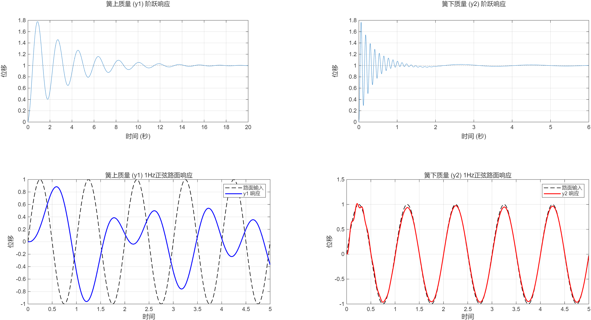
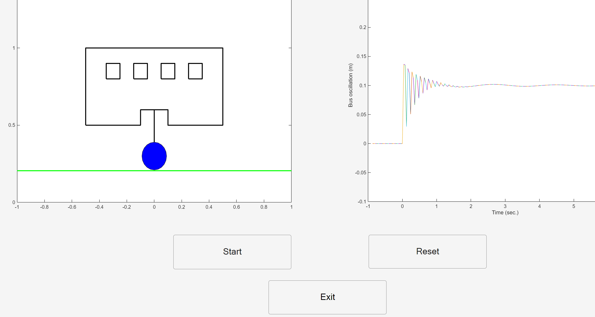
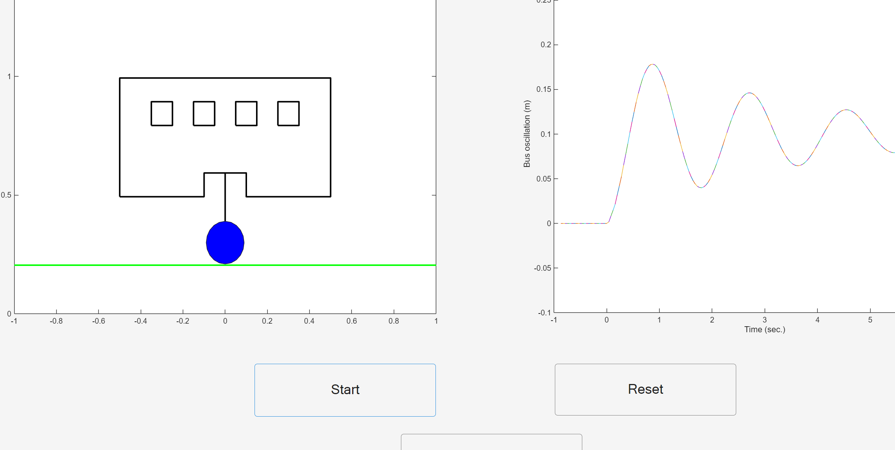

# Computer_Lab_One

### 实验目的
1.掌握 1/4 车辆模型的传递函数推导与$Matlab$实现。   
2.分析系统在阶跃输入和正弦输入下的响应。    
3.利用 GUI 文件实现车辆响应动画，并观察参数变化对系统性能的影响。   


### 1/4 车辆悬架模型

| 符号 | 物理意义 | 数值 | 单位 |
| :--- | :--- | :--- | :--- |
| m_1 | 簧载质量（车身） | 465 | kg |
| m_2 | 非簧载质量（车轮） | 50 | kg |
| k_1 | 悬架弹簧刚度 | 5700 | N/m |
| k_2 | 轮胎径向刚度 | 135000 | N/m |
| b | 悬架阻尼系数 | 290 | N·s/m |
| y_1 | 车身位移 | - | m |
| y_2 | 车轮位移 | - | m |
| y | 路面输入位移 | - | m |

---
### 系统运动微分方程

该二自由度系统的动力学方程如下：

1. **车身受力平衡：**
$$
  m_1 \ddot{y}_1 + b(\dot{y}_1 - \dot{y}_2) + k_1(y_1 - y_2) = 0
$$


2. **车轮受力平衡：**
$$
  m_2 \ddot{y}_2 + b(\dot{y}_2 - \dot{y}_1) + k_1(y_2 - y_1) + k_2(y_2 - y) = 0
$$


---

### 传递函数

进行拉普拉斯变换之后，可以得到传递函数

#### 1. 路面输入到簧上质量位移的传递函数 G_1(s)

$$
G_1(s) = \frac{Y_1(s)}{Y(s)}=\frac{k_2(bs + k_1)}{m_1 m_2 s^4 + (m_1 + m_2)b s^3 + [m_1(k_1 + k_2) + m_2 k_1]s^2 + b k_2 s + k_1 k_2}
$$

#### 2. 路面输入到簧下质量位移的传递函数 G_2(s)

$$
G_2(s) = \frac{Y_2(s)}{Y(s)}=\frac{k_2(m_1 s^2 + bs + k_1)}{m_1 m_2 s^4 + (m_1 + m_2)b s^3 + [m_1(k_1 + k_2) + m_2 k_1]s^2 + b k_2 s + k_1 k_2}
$$

### 代码

```matlab
m1 = 465 ;
m2 = 50 ;
k1 = 5700 ;
k2 = 135000 ;
b = 290 ; 
syms s ;

u1 = [k2];
u2 = [b,k1];
Y1 = conv(u1,u2);

v1=[k2];
v2=[m1,b,k1];
Y2 = conv(v1,v2);

w1=[m2,b,k1+k2];
w2=[m1,b,k1];
w3 = [b,k1];
Y = conv(w1,w2) - [0,0,conv(w3,w3)];


G_1 = tf(Y1, Y);
disp(G_1);
G_2 = tf(Y2, Y);
disp(G_2);
```

代码首先定义了 1/4 悬架系统的物理参数，通过拉普拉斯变换，利用多项式卷积函数 conv 构建了系统的特征方程。具体推导了两个核心传递函数：G_1(s)：路面输入至车身位移（簧上质量）的传递函数，用于评价车辆的乘坐舒适性。G_2(s)：路面输入至车轮位移（簧下质量）的传递函数，用于评价车辆的操纵稳定性。

```matlab
% --- 仿真参数 ---
t = 0:0.01:5;           % 时间范围
u_sin = sin(2*pi*1*t);  % 1Hz 正弦路面输入

% --- 绘图部分 ---
figure('Name', 'Quarter Car Model Simulation', 'Color', 'w', 'Position', [100, 100, 1000, 600]);

% 1. k1弹簧上质量 (y1) 阶跃响应
subplot(2,2,1);
step(G_1);
title('簧上质量 (y1) 阶跃响应');
ylabel('位移');
grid on;

% 2. k1弹簧下质量 (y2) 阶跃响应
subplot(2,2,2);
step(G_2);
title('簧下质量 (y2) 阶跃响应');
ylabel('位移');
grid on;

% 3. k1弹簧上质量 (y1) 正弦响应
subplot(2,2,3);
[y1_out, ~] = lsim(G_1, u_sin, t);
plot(t, u_sin, '--k', 'LineWidth', 1); hold on;
plot(t, y1_out, 'b', 'LineWidth', 1.5);
title('簧上质量 (y1) 1Hz正弦路面响应');
xlabel('时间'); ylabel('位移');
legend('路面输入', 'y1 响应');
grid on;

% 4. k1弹簧下质量 (y2) 正弦响应
subplot(2,2,4);
[y2_out, ~] = lsim(G_2, u_sin, t);
plot(t, u_sin, '--k', 'LineWidth', 1); hold on;
plot(t, y2_out, 'r', 'LineWidth', 1.5);
title('簧下质量 (y2) 1Hz正弦路面响应');
xlabel('时间'); ylabel('位移');
legend('路面输入', 'y2 响应');
grid on;
```

时域动态响应分析仿真部分模拟了两种典型的路面工况，以全面考量系统的动态特征：

- 阶跃响应 (Step Response)：使用 step 函数模拟车辆突然驶过凸起障碍物（如路缘石）的瞬态过程。通过分析响应的超调量和调节时间，可以直观地判断悬架系统的衰减特性和稳定性。
- 正弦响应 (Sine Response)：使用 lsim 函数模拟频率为 1Hz 的连续波动路面。此项仿真用于观察系统在周期性激励下的增益情况（即振幅衰减程度）以及相位滞后。

最后将结果可视化，通过 subplot 指令生成了四组对比曲线。这种多维度的可视化方案能够清晰地展示路面输入与车身、车轮位移之间的耦合关系，为后续调整阻尼系数和刚度参数提供了直观的数据支撑。

### 结果



通过对上述四组仿真曲线的观察，可以得出以下结论：
#### 3.1 阶跃响应分析 (Step Response)
簧上质量 (y_1)：在单位阶跃输入下，y_1 呈现出明显的欠阻尼振荡特性。波峰出现在约 0.5s 处，随后在 2s 内趋于平稳。这表明悬架系统能够有效地支撑车身重量，并具有一定的能量耗散能力。

簧下质量 (y_2)：相对于车身，车轮的响应速度极快，且振荡频率显著更高。这是由于车轮质量 m_2 远小于车身 m_1，且轮胎刚度 k_2 较大导致的。
#### 3.2 正弦路面响应分析 (Sine Wave Response)
振幅抑制：在 1Hz 的正弦激励下，蓝色实线（车身响应 y_1）的幅值明显小于虚线（路面输入）。这定量地说明了悬架系统在此频率下具有良好的隔振性能，能够显著提升乘坐舒适性。相位滞后：观察曲线可见，响应输出相对于路面输入存在一定的相位滞后，这是系统阻尼 b 对能量吸收和延迟作用的典型体现。车轮跟踪性：红色实线（车轮响应 y_2）能够较好地跟随路面起伏，这保证了轮胎在行驶过程中能持续接触地面，从而维持必要的抓地力和操纵稳定性。 

## 任务二 

实验一可以获得关于Y1，Y2和Y的具体的表达式，其中参数分别如下

#### 1. 簧上质量分子多项式 Y_1(s)

$$
Y_1(s) = 39,150,000s + 769,500,000
$$

#### 2. 簧下质量分子多项式 Y_2(s)

$$
Y_2(s) = 62,775,000s^2 + 39,150,000s + 769,500,000
$$

#### 3. 系统特征分母多项式 Y(s)
$$
Y(s) = 23,250s^4 + 149,350s^3 + 65,710,500s^2 + 39,150,000s + 769,500,000
$$


### 代码

```matlab
m1=465;
m2=50;
k1 = 5700;
k2 = 135000;
b1 = 290;
  
%numa = [39150000 769500000];
numa = [62775000 39150000 769500000];
dena = [23250 149350 65710500 39150000 769500000];
```

### 结果



通过 MATLAB 动画仿真界面可以直观观察到：当车轮（蓝色圆球）跨越阶跃障碍时，系统立即产生响应。右侧响应曲线清楚地揭示了悬架系统的动力学过程：初期呈现出高频冲击特性，随后在阻尼器的作用下，振荡波峰迅速衰减，最终在约 3.5 秒后达到新的平衡位置。这说明该组参数配置能够保证车辆在受到大冲击后快速恢复平稳，有效地兼顾了行驶平顺性与结构安全性。



本系统不仅能在面对突发冲击时快速收敛，也能在面对连续起伏路面时，通过悬架的柔性连接和阻尼衰减，将振动控制在合理的范围内。这充分验证了该 1/4 悬架模型在多种复杂工况下的鲁棒性和参数设计的合理性。

