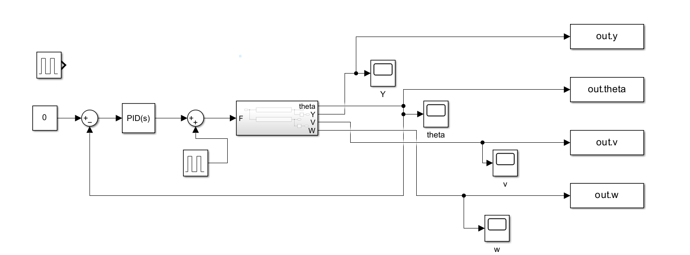
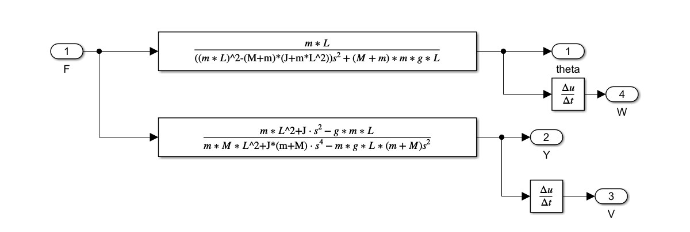
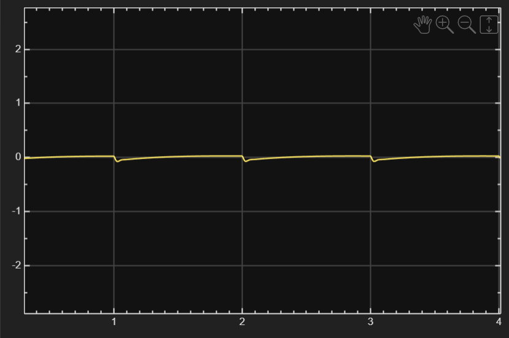
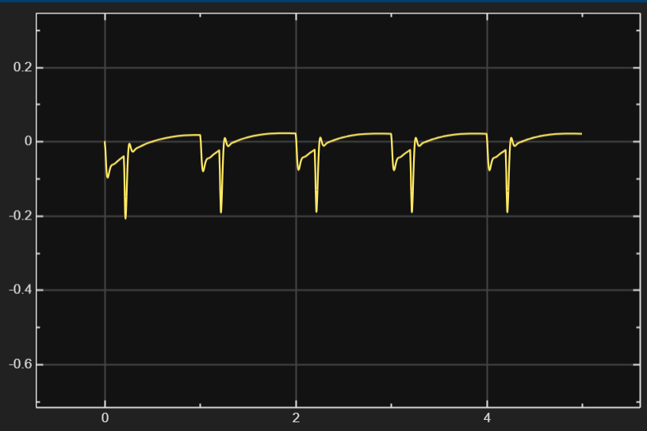
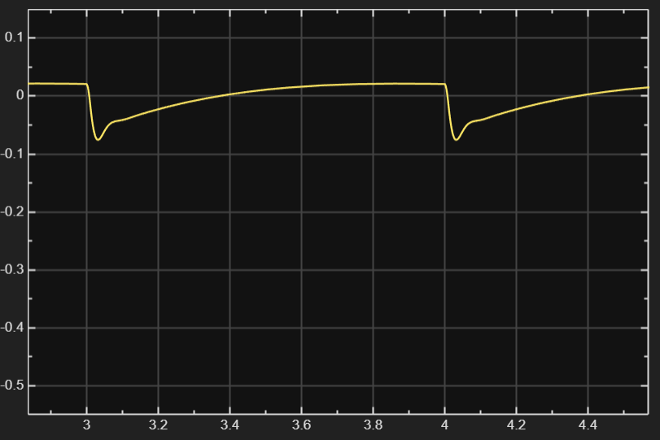
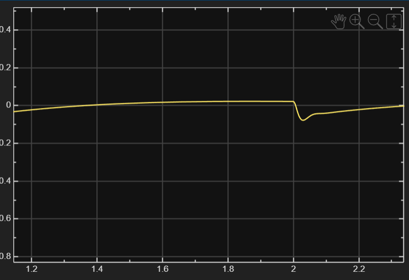
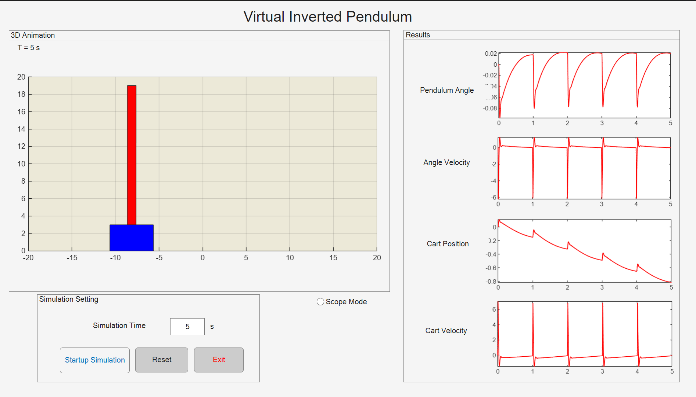

# Computer_Lab_Two

## 系统建模

1)  如下为运动方程
$$
(M + m)\ddot{y} + mL\ddot{\theta}\cos\theta - mL\dot{\theta}^2\sin\theta = F
$$

$$
(J + ML^2)\ddot{\theta} + mL\ddot{y}\cos\theta - mgL\sin\theta = 0
$$

2) 求解传递函数
将运动方程进行Laplace变换，然后使用$matlab$进行求解：

```matlab
syms s M m L g I F Y Theta  % 定义符号
eq1 = (M + m)*s^2*Y + m*L*s^2*Theta == F;
eq2 = m*L*s^2*Y + (I + m*L^2)*s^2*Theta - m*g*L*Theta == 0;

sol = solve([eq1, eq2], [Y, Theta]);
G1 = simplify(sol.Theta / F);  
T2 = simplify(sol.Y / F)
```

$$
\frac{\Theta(s)}{F(s)}=\frac{m \cdot L}{((m \cdot L)^2 - (M + m) \cdot (J + m \cdot L^2))s^2 + (M + m) \cdot m \cdot g \cdot L}
$$

$$
\frac{Y(s)}{F(s)}=\frac{(m \cdot L^2 + J) \cdot s^2 - g \cdot m \cdot L}{ (m \cdot M \cdot L^2 + J \cdot (m + M)) \cdot s^4 - m \cdot g \cdot L \cdot (m + M)s^2 }
$$

3) $simulink$仿真
首先在$matlab$的$workspace$设置基本的变量

```matlab
m = 60 ;
M = 47.7;
L = 1.7/2 ;
J = m * L^2 / 3 ;
g = 9.81;
```
然后在$simulink$进行仿真，如下图




## 控制器设计

1) 通过调节 $PID 参数$，使 $\Theta$ 保持在 $-\pi/6 \leq \theta \leq \pi/6$ 范围内。

设置如下：
| 参数 | 数值 |
| :--- | :--- |
| **P** (比例增益) | -20000 |
| **I** (积分增益) | -30000 |
| **D** (微分增益) | -6000 |
| **N** (滤波器系数) | 100 |



2. 输入一个幅值为$-20$度的阶跃信号，约等于$-0.349rad$，不修改$PID$参数，theta的曲线如下图：

在每个阶跃跳变点，摆角 $\theta$ 产生了一个向下的瞬时峰值，约为 $-0.2\,\text{rad}$。系统表现出一定的跟踪趋势，但在当前的 $PID $参数下，摆角并没有完全平稳地停留在 $-0.349\,\text{rad}$ 的位置，而是表现为一种带有脉冲补偿的动态平衡。




3) 修改$driver$的重量，当为1.2倍时，



当为0.8倍时，


由对比可知，该系统目前的鲁棒性较好，$m$发生变化的时候，$\theta$的变化幅度较小，基本保持稳定。


4) 使用简易实验平台进行可视化

* **角度稳定性**：在连续脉冲干扰下，摆角 $\theta$ 始终保持在 $[-0.1, 0.02]\,\text{rad}$ 范围内，调节时间约 $0.7\,\text{s}$，完全符合1 秒内稳定及约束区间。
* **运动状态**：角速度与车速在干扰瞬时产生尖峰，但随之迅速衰减，证明微分项 $D$ 提供了有效的系统阻尼。