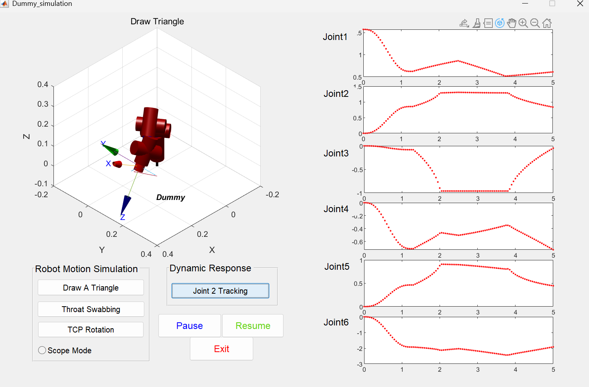
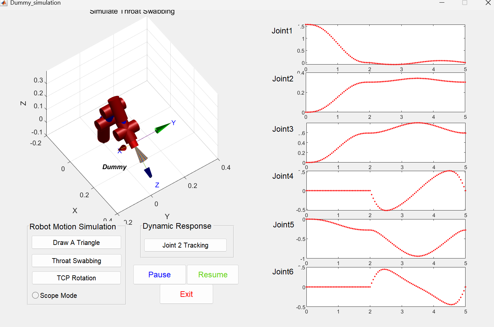
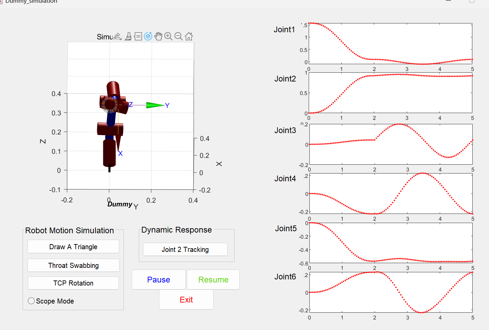
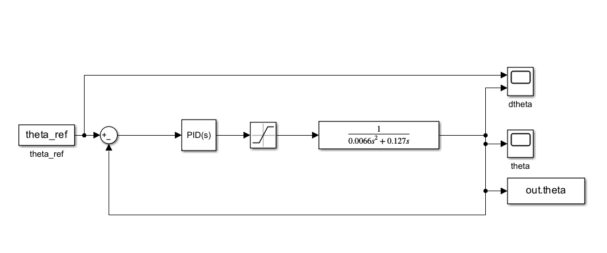
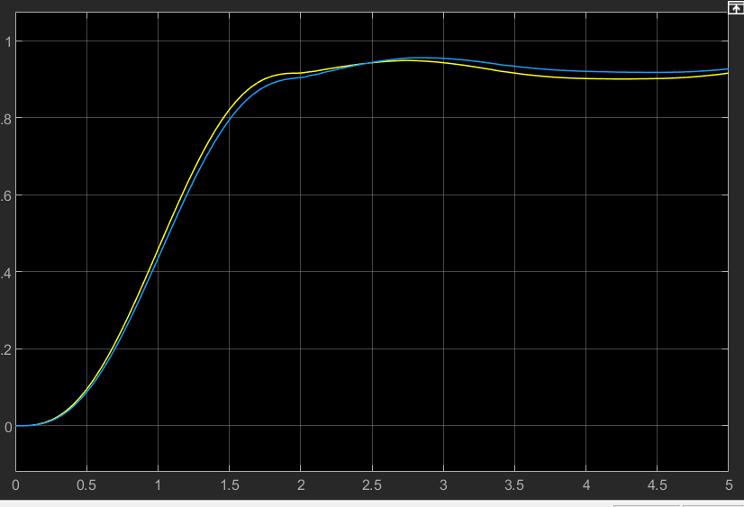

## Computer_Lab_Three

实验一：修改三角形的三个顶点坐标以及末端姿态，参数如下：

```matlab
trip1 = [0.25;0.15;0.1];       
trip2 = [0.25;0.25;0.1];
trip3 = [0.30;0.15;0.1];

%RPY世界坐标系欧拉角，roll、pitch、yaw。
T1_roll = -pi;
T1_pitch = -pi/6; 
T1_yaw = 0;
```

实验结果如下图所示



结果显示 Joint 1 至 Joint 6 的运动曲线均表现出一定的平滑性与连续性。观察可知，所有关节的点迹过渡自然，表明轨迹已避开关节物理限位并处于高灵活性工作空间内；同时，腕部关节 Joint 4、5、6 无任何点迹跳变，证明轨迹成功规避了底座轴线附近的奇异区域，逆运动学算法始终锁定了唯一最优姿态解。

实验二: 模拟机器人末端执行器执行咽拭子采集任务的关节运动。

修改参数如下：

```matlab
T2_pn = [0.25; 0.0; 0.15]; %旋转运动的圆锥顶点
T2_psi = linspace(0, 2*pi, Num+1);   %水平面方位旋转角       
T2_theta = deg2rad(12) * ones(1, Num+1);  %拭子相对于中心轴线的张角
T2_phi = linspace(0, pi, Num+1); %拭子绕其自身长轴的旋转
```

同时，修改代码报错，修改115，297行附近的代码，将所有涉及向量相乘、相除以及乘方的运算符统一修正为点运算符号。

```matlab
T2_yaw = asin(-(sin(T2_phi).*cos(T2_theta).*cos(T2_psi) + cos(T2_phi).*sin(T2_psi)) ./ ...
         sqrt(1-(sin(T2_theta).*cos(T2_psi)).^2));
         
         
x = tan(T2_theta).*r.*cos(T2_psi);
y = -tan(T2_theta).*r.*sin(T2_psi);
```

实验结果如下图所示：


结果显示：关节曲线连续，没有任何跳变，机器人有效避开了奇异点区域。

实验三： 模拟机器人末端执行器绕工具中心点（TCP）旋转的关节运动。

修改参数如下：

```matlab
N = [-0.9191 0 0.3939];
c = [0 0 1];
a = cross(N, c);
a = a / norm(a);
b = cross(N, a);
b = b / norm(b);
r = 0.04;
Num = 60;
T3_pn    = zeros(61,3);
T3_roll  = zeros(61,1);
T3_pitch = zeros(61,1);
T3_yaw   = zeros(61,1);

T3_psi   = linspace(0, 2*pi, Num+1)';  % 绕圆一周的角度参数
T3_theta = deg2rad(12) * ones(Num+1, 1);% 锥半顶角12°，保持恒定
T3_phi   = T3_psi;

p0 = [0.15; 0.0; 0.18];% 锥顶点（TCP远端固定点）

h = r / tan(deg2rad(12));   % 锥高 h = r/tan(θ)
center = p0 - h * (N/norm(N))'; % 圆心 = 锥顶 沿-N方向偏移锥高h

%锥底圆上各点坐标
for i = 1:Num+1
    T3_pn(i,:) = center' + r*cos(T3_psi(i))*a + r*sin(T3_psi(i))*b;
end

for i = 1:Num+1
    pe   = T3_pn(i,:)';
    Znew = pe - p0;            
    Znew = Znew / norm(Znew);
    T3_pitch(i) = asin(-Znew(2));
    T3_roll(i)  = atan2(Znew(1), Znew(3));
    T3_yaw(i)   = 0;
end

x = (tan(T3_theta) .* r .* sin(T3_psi))';
y = (-tan(T3_theta) .* r .* cos(T3_psi))';
z = zeros(1, Num+1);
```

此外，修改代码，将所有涉及向量相乘、相除以及乘方的运算符统一修正为点运算符号。

实验结果如下图所示：


从上图可知，关节角度曲线全部连续并且较为光滑，说明求解稳定，锥形扫描轨迹正确，姿态合理

实验四：机械臂关节2的PID控制：

PID参数如下所示

| 参数               | 数值 |
| :----------------- | :--- |
| **P** (比例增益)   | 1.5  |
| **I** (积分增益)   | 1.6  |
| **D** (微分增益)   | 2    |
| **N** (滤波器系数) | 15   |

simulink仿真图如下图所示：


仿真结果如下图所示：


当前系统的PID调优已达到**高响应、低延迟**的优秀水平：通过高比例增益实现了较好的动态追踪能力，使上升沿几乎与参考线重合；虽然导致在 $2.8s$ 附近仍有微小超调，但整体波形平滑且收敛稳定。
